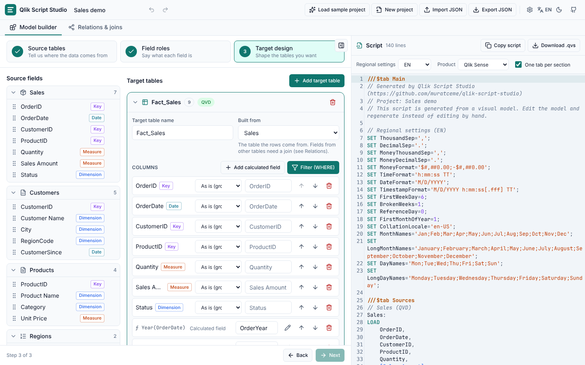
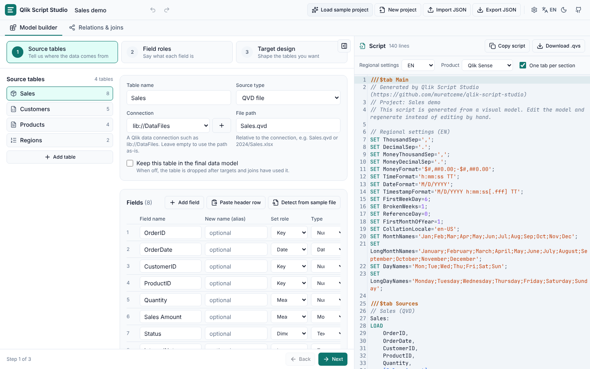
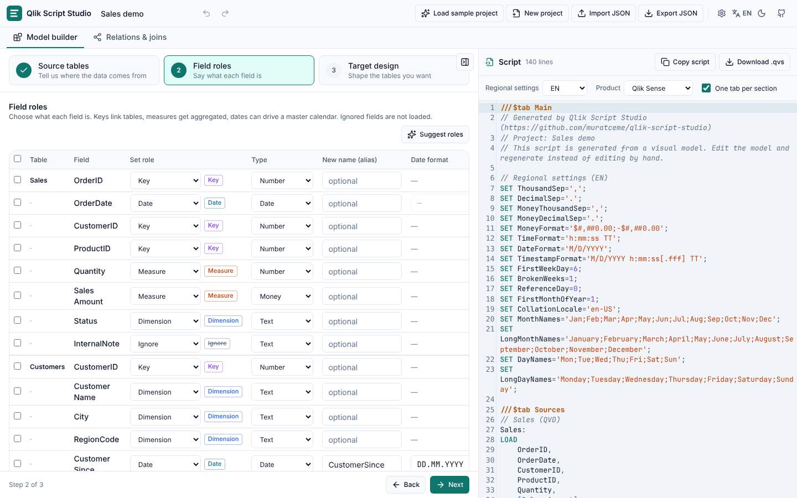
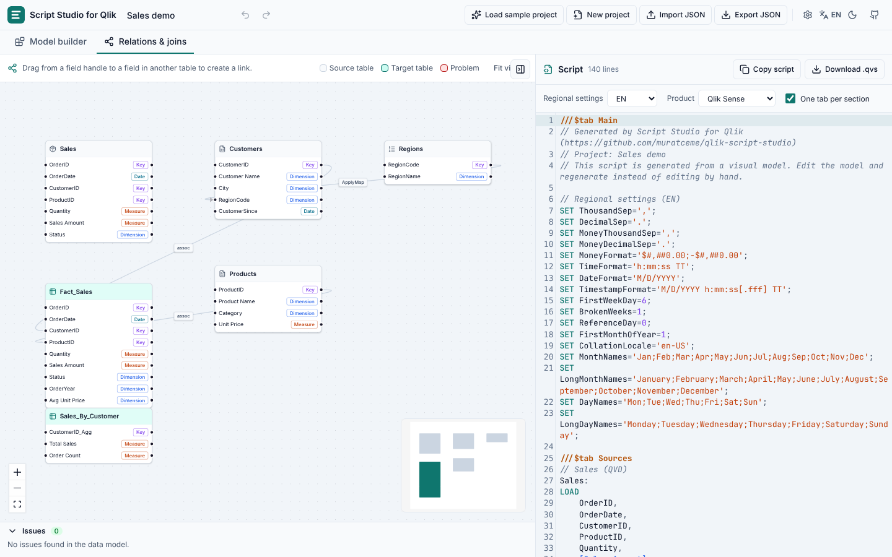
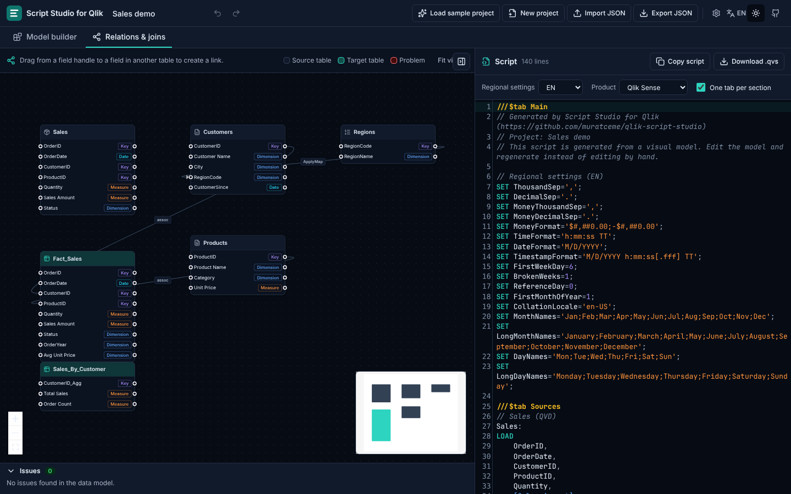

# Qlik Script Studio

**Build Qlik Sense / QlikView load scripts visually, without writing code.**
Describe your source tables, say what each field is, shape the tables you want,
draw the relationships, and copy the generated script into Qlik.

Everything runs in your browser. There is no backend, no account and no AI:
the script is produced by a deterministic, rule-based generator, so the same
model always gives the same script.

**Live app:** https://muratceme.github.io/qlik-script-studio/



## Features

**Model builder (3-step wizard)**

- _Source tables_: QVD, Excel, CSV / text, database (SQL) and inline tables,
  with `lib://` connections, sheet names, delimiters, encodings and header options.
- _Fields_ entered by hand, pasted from a header row, or detected from a sample
  CSV / XLSX file (only the header and the first rows are read, locally).
- _Field roles_: dimension, measure, key, date or ignore; data types; aliases;
  date formats; bulk editing with multi-select; opt-in role suggestions
  (`…ID`, `…Key`, `…Code` → key, `…Date` → date, numeric `Amount` / `Qty` → measure).
- _Target design_: drag fields into target tables, pick aggregations (Sum,
  Count, Count distinct, Avg, Min, Max, First / Last value) with automatic
  `GROUP BY`, build `WHERE` filters with AND / OR groups, create calculated
  fields with a form (combine text, arithmetic, percentage, If / then / else,
  date parts, ApplyMap, AutoNumber, or a raw expression), add a master calendar
  with one click, `STORE` any target as QVD, and preview how each table will look.

**Connecting tables**

- Drop a field from another table into a target and the app asks, in plain
  language, how the two tables should be connected: add its columns (join),
  keep both and link them (association), or append its rows (concatenate).
  Matching fields are guessed from names and keys; one more click opens every
  other relationship type.
- Problems are shown next to the column they belong to, with a "Connect…"
  button, instead of only in the script panel.

**Relations & joins**

- Tables on a canvas with their fields; drag from one field to another to link.
- Association, Left / Right / Inner / Outer Join, Left / Right / Inner Keep,
  Concatenate, NoConcatenate and ApplyMap, with the merge direction, multiple
  field pairs and composite keys (concatenated text or AutoNumber).
- Problems are highlighted in red with one-click fixes: synthetic keys, circular
  references, key type mismatches, join fan-out risk, unintended common fields
  and implicit concatenation.

**Script output**

- Live preview with Qlik syntax highlighting, copy, download as `.qvs`,
  optional `///$tab` section per block.
- Regional presets (EN / TR `SET` variables), Qlik Sense or QlikView path style.
- Readable, commented, valid script: bracketed names where needed, mapping
  tables before use, resident loads with `NoConcatenate`, correct
  `LEFT JOIN (Target) LOAD … RESIDENT Source;` forms, cleanup of temporary tables.
- Clear English / Turkish error messages before an invalid model becomes a script.

**Project handling**

- Autosave in the browser (localStorage), JSON import / export, undo / redo
  (`Ctrl+Z` / `Ctrl+Shift+Z`), sample project, light / dark theme, keyboard
  accessible, interface in English and Turkish.

| Source tables                               | Field roles                             |
| ------------------------------------------- | --------------------------------------- |
|  |  |

| Relations & joins                               | Dark theme                            |
| ----------------------------------------------- | ------------------------------------- |
|  |  |

## Local setup

Requires Node.js 20 or newer.

```bash
npm install
```

```bash
npm run dev
```

Other scripts:

| Command             | What it does                                                      |
| ------------------- | ----------------------------------------------------------------- |
| `npm test`          | Vitest unit and snapshot tests (generator, model, UI smoke tests) |
| `npm run lint`      | ESLint                                                            |
| `npm run typecheck` | TypeScript in strict mode                                         |
| `npm run build`     | Production build to `dist/`                                       |
| `npm run preview`   | Serve the production build locally                                |

## How it works

The whole UI edits a single typed JSON **project model**
(`src/model/types.ts`). The script is produced from that model by a pure,
deterministic function in `src/generator` (`generateScript(model)`), which has
no dependency on React or the browser and is covered by snapshot tests. The
generator also validates the model (errors block generation) and analyses the
resulting data model (warnings with one-click fixes).

```
src/
├── model/       project types, zod schema, defaults, migrations, sample project
├── generator/   validate · analyze · emit (settings, sources, targets, links, calendar, store, cleanup)
├── store/       zustand stores (persisted project with undo/redo, UI state) and actions
├── features/    sources · roles · targets · relations · script · project
├── components/  UI primitives
├── i18n/        en.json, tr.json
└── app/         shell, tabs, header
```

The full design is in [docs/PLAN.md](docs/PLAN.md).

## Claude skill

The generation rules are also published as a Claude skill in
[`skills/qlik-load-script-builder/SKILL.md`](skills/qlik-load-script-builder/SKILL.md).
It contains the project JSON schema, the script generation rules, the
validation and analysis codes, a syntax checklist and a worked example. A test
(`src/generator/__tests__/skill.spec.ts`) checks that the example in the skill
is exactly what the generator produces, so the two cannot drift apart.

To install it in Claude Code, copy the skill folder into your personal or
project skills directory:

```bash
mkdir -p ~/.claude/skills
```

```bash
cp -r skills/qlik-load-script-builder ~/.claude/skills/
```

or, for one project only:

```bash
cp -r skills/qlik-load-script-builder .claude/skills/
```

Then ask Claude for a Qlik load script, or invoke `/qlik-load-script-builder`.
Claude will build the same project JSON the app uses (you can import it into
the app) and write the script with the same rules.

## Limitations

- Sample files are only used to detect fields and show preview rows; the app
  never loads or transforms real data.
- Target tables are built from one primary table with `RESIDENT`. Fields of
  other tables must come through a join or concatenate link into that table.
- Calculated fields cover the common cases; anything else goes in a
  "custom expression" that is written to the script as-is.
- Excel parsing uses the `xlsx` package from npm (0.18.x). Newer releases are
  only distributed through the SheetJS CDN; if your policy requires them,
  replace the dependency with `https://cdn.sheetjs.com/xlsx-0.20.3/xlsx-0.20.3.tgz`.
- The generated script is not executed or syntax-checked against Qlik; it
  follows the documented rules and the snapshot tests, so review it before
  running it on production data.

## Deployment

Every push runs lint, typecheck, tests and build in GitHub Actions. Pushes to
`main` also deploy `dist/` to GitHub Pages (the Vite `base` is derived from the
repository name). GitHub Pages must be set to **Source: GitHub Actions** once in
the repository settings; the workflow tries to enable it automatically.

## License

[MIT](LICENSE)
